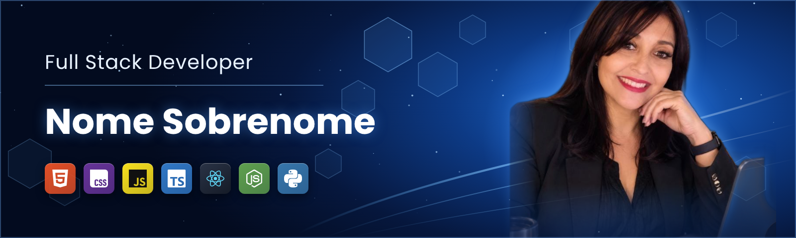

 

 

## Sobre

Desenvolvedora  Full Stack Pleno  com  2 ANOS anos de experiência  no desenvolvimento de aplicações web, APIs e sistemas corporativos. Atuo de ponta a ponta no ciclo de desenvolvimento, da modelagem de dados ao deploy, com foco em **performance, qualidade de código e experiência do usuário**.

Atualmente na WS TECNOLOGIA , onde trabalho com **[EX: microsserviços em Node.js e front-end em React]** para **[EX: uma plataforma com milhares de usuários ativos]**.

<table>
<tr>
<td valign="top" width="50%">

**Áreas de atuação**
- Desenvolvimento de APIs REST e GraphQL
- Interfaces responsivas e acessíveis
- Modelagem e otimização de banco de dados
- Integração contínua e deploy em nuvem
- Code review e mentoria de devs júnior

</td>
<td valign="top" width="50%">

**Práticas que aplico**
- Clean Code e princípios SOLID
- Testes automatizados (unitários e integração)
- Arquitetura em camadas / Clean Architecture
- Metodologias ágeis (Scrum / Kanban)
- Versionamento com Git Flow

</td>
</tr>
</table>

 

## Stack

> Ajuste os ícones para refletir a stack real.

**Linguagens**  

  

**Front-end**  

  

**Back-end & Dados**  

  

**Cloud, DevOps & Ferramentas**  

 

